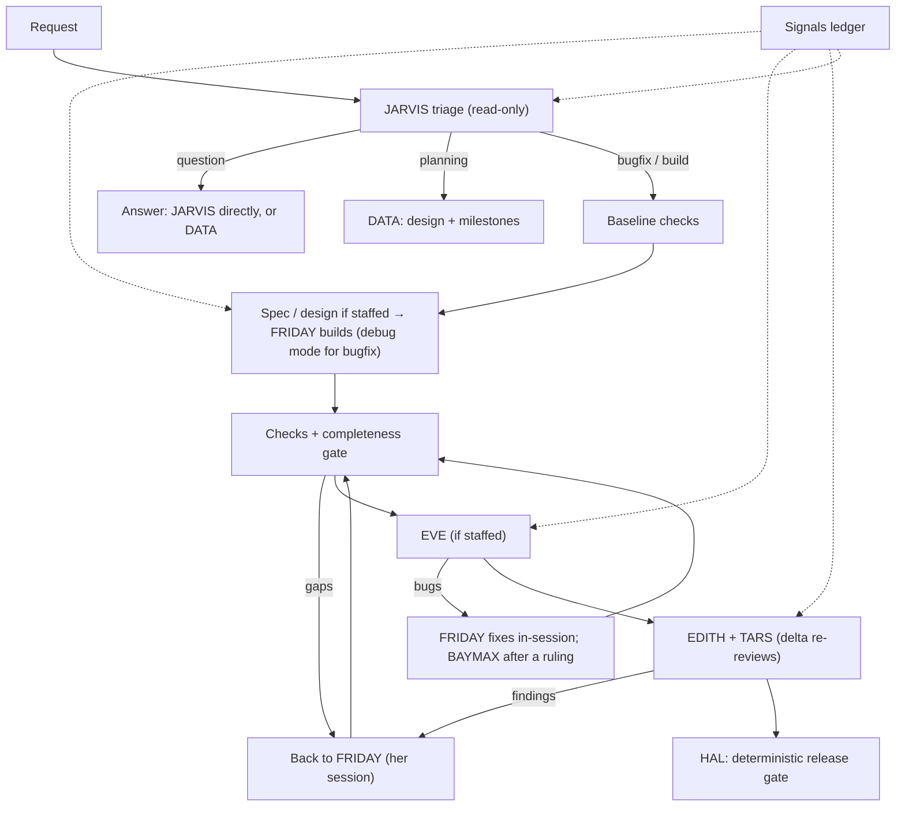

# Architecture, audit and v0.3 changes

This document records how the system worked when v0.3 started, what was verified to be wrong with it, what changed, and what the measurements say. Every "verified" item has a failing test that reproduced it before the fix (`test/adaptive.test.ts`) or a measurement in `bench/results/`. Hypotheses are marked as such.

## 1. How v0.2 actually worked (traced, not assumed)

- **Entry points.** `src/cli.ts` (`ai-team build|resume|status|report|init|onboard`) and the programmatic `Orchestrator` (`src/index.ts`). Agents run through `ClaudeCodeProvider` (Claude Agent SDK `query()`), one SDK session per call, each with a role system prompt (playbook + stack packs + project profile + rulebook) appended to the Claude Code preset, a JSON-schema output contract, an allowlist of tools and a `PreToolUse` hook that limits file writes.
- **Orchestration.** `Orchestrator.drive()` is a resumable state machine over `RunState.next`: `baseline → plan → pm → clarify → design → develop → checks → qa → fix → arbitrate → review → rework → release → debrief`. State is persisted after every step (`.ai-team/runs/<id>/state.json`).
- **Delegation.** JARVIS's plan (`MissionPlan`) sets size, risk, a lineup (`off/light/full` per member) and per-member effort. Deterministic guardrails (`guardrails.ts`) can only raise the lineup — from JARVIS's own risk areas and, after each code change, from the measured git diff.
- **Communication.** There was no messaging between members. Each step's prompt is assembled by the orchestrator from upstream artifacts (spec, design, diff, findings). Free-text fields such as the developer's `notes` were only rendered into reports.
- **Questions.** Only the PM could ask the human (`openQuestions`), and only before development.
- **Verification.** The orchestrator runs configured checks (baseline + after every change), ties every verdict to a code revision, and HAL (`release.ts`) approves only when every staffed stage passed against the latest revision.
- **Loops.** QA findings → BAYMAX (fresh session) → checks → QA again; review findings → FRIDAY (fresh session) → checks → QA → both reviewers again. Recurring or disputed items go to JARVIS (fix / waive MEDIUM-LOW / escalate).

## 2. Verified problems

| # | Problem | Evidence | Status |
|---|---|---|---|
| 1 | HAL approved a mission whose developer reported an acceptance criterion as `PARTIAL`/`NOT_DONE`. Coverage was rendered, never checked. | Test *"a developer who reports an acceptance criterion as not done cannot be approved"* — approved on v0.2 | fixed |
| 2 | HAL approved an implementation mission that changed no code at all. | Test *"an implementation mission that changed no code is not approved"* — approved on v0.2 | fixed |
| 3 | Read-only members could change the repository through Bash (QA has a shell; the write hook only sees Edit/Write). v0.2 detected it with `git status` and recorded a WARN, but left the edits in place. | Test *"files a read-only member changed … are restored"* — edits survived on v0.2 | fixed |
| 4 | `plan.surfaces` (e.g. `frontend`) was rendered and never used: a request needing UI work could ship with only the API, silently. | Test *"a planned frontend surface with no frontend change is sent back"* — approved on v0.2 | fixed |
| 5 | Every request was forced into implementation: there was no answer-only or plan-only path (`taskType` had no `question`/`planning`). | Test *"a question is answered … no developer"* — v0.2 called the developer | fixed |
| 6 | Roles could not talk outside their deliverable: no way for QA to challenge the design, for the developer to request a security review, to report a blocker, or for anyone but the PM to ask the human. | Code: no channel in any output schema; `dev.notes` only rendered | fixed (signals) |
| 7 | Every call pays a fixed ~11–13k-token system-prompt cache write; JARVIS's prompt carried all four of his modes on every call; a tool-less debrief still carried the Claude Code preset. | `bench/results/baseline-v0.2.2`: plan $0.06–0.08, debrief $0.06–0.07 even on clean missions | reduced |
| 8 | Fix rounds cold-started BAYMAX, who re-read the code (coupons: 14 turns, 302k cache-read tokens, $0.28); second review rounds re-read the whole diff. | `bench/results/baseline-v0.2.2/02-coupons.json` | reduced |
| 9 | Agents started from inside a Claude Code session inherited its session id, so every member wrote to the same session transcript. | Live probe: three independent `query()` calls reported the same `session_id` until the parent's variables were removed | fixed |
| 10 | Baseline checks ran before planning, so questions and plans paid for a full test run. | Smoke run of a question mission | fixed |

Found and fixed during this work (introduced and caught before release): snapshots of the working tree must keep the original index timestamp or git misses same-size edits made in the same second (racy git) — test *"snapshots see a same-size edit made in the same second"*; and the SDK reports a **resumed** session's cost cumulatively, which double-counted the developer's first call — test *"a resumed session is charged only for its new work"*.

**Environment finding (not a product bug).** The benchmark fixture's `npm test` (`node --test test/`) cannot start on Node 22 (it expects a file or glob). Every run in this round — baseline and new — therefore saw the configured test check as "already failing before the mission". Both versions ran under the same condition; the hidden-test scoring is unaffected because it runs test files directly.

## 3. Target architecture (what v0.3 implements)

Principles, in order: task success over agent count; evidence over claims; the cheapest path that can still verify the result.

**Adaptive routing.** JARVIS classifies the task type before sizing. `question` ends with an answer (one call when his triage settles it), `planning` ends with DATA's plan, `bugfix` runs the developer in debugging mode, everything else is a build sized XS–XL as before.

**Completeness, deterministic.** `src/completeness.ts` computes the gaps between the current state and "done": criteria reported incomplete, planned surfaces with no matching change, no change at all, open blockers, and human decisions that differ from what was built. The orchestrator sends gaps back to the developer before testing; HAL fails on any that remain. Gaps can be waived only by JARVIS (MEDIUM) or the human, with the reason recorded.

**Collaboration without broadcast.** Every working member's output carries `signals` (`question`, `assumption`, `concern`, `recruit`, `blocker`). The orchestrator routes them: recruits raise the lineup (never lower it) and the flow reaches the new member; human questions are asked once; blockers go to JARVIS through the existing arbitration path; assumptions reach everyone who checks the work (so they aren't reported as bugs); concerns reach only their addressee. Each prompt gets only its own entries (`teamNotes`), so context stays small. Reasoning is unrestricted; tool permissions are not — read-only members' stray edits are undone.

**Session reuse and deltas.** The developer fixes QA's findings and reworks review findings in her own resumed session (cache hits on her context, short prompts); BAYMAX joins with fresh eyes when JARVIS rules that the approach must change, or if the session can't be resumed. Re-tests and re-reviews get only the diff since the member last looked (working-tree snapshots per code revision). A reviewer whose approval still covers the current code is not asked again.

**Right-sized output.** Answers print in the terminal; solo approvals print one line; the HTML report opens for team missions and plans; the AI-written debrief runs only when something happened worth learning from.

### Deliberately not done

- **No free-form agent chat or new "designer" role.** Conversation between agents multiplies tokens with no verification benefit; a structured, routed ledger gives the same information. UI completeness is enforced by the surface check instead of an extra agent; a project that wants a dedicated UI reviewer can staff the reviewer with a UI-focused playbook override.
- **No automatic model downgrades.** Smaller models for light-depth roles may be cheaper, but nothing here measured that they keep finding the same bugs. `models.<role>` already allows it per project.
- **No skipping the planning call for tiny tasks.** It costs about $0.06; JARVIS's triage is what keeps big tasks safe, and guessing size without reading code is how risky work gets under-staffed.

## 4. Migration and compatibility

- Public API unchanged: `Orchestrator`, `ClaudeCodeProvider`, `loadConfig`, `MockProvider`.
- Config: new optional `loop.fixer` (`auto` | `bugFixer`). Existing configs load unchanged.
- State: new optional fields (`coverage`, `signals`, `snapshots`, `sessions`, `answer`); v0.2 mission state files still load and resume. New statuses `answered` and `planned`; the CLI exits 0 for them.
- Output contracts gained fields (see CHANGELOG). Custom `AIProvider` implementations that fabricate outputs must include them.
- Behavior changes to expect: missions that v0.2 approved with criteria marked partial, with no code change, or without planned UI work are now sent back or rejected; QA findings are fixed by FRIDAY first (`"loop": { "fixer": "bugFixer" }` restores v0.2 behavior).

## 5. Measurements

See `bench/RESULTS.md` (generated) and the summary in section 6. Conditions: same container, same SDK and default model, same day, fixture and hidden tests; `--yes` (no human); two runs per contender and scenario where marked.

## 6. Results and trade-offs

_Filled in from the Proving Ground runs below._

## 7. Open risks and next steps

- **Variance.** Two runs per scenario cannot separate small effects from noise; the coupons mission alone varied between two and three fix rounds. Treat per-scenario cost differences under ~25% as noise.
- **Completeness depends on honest coverage.** A developer who claims `DONE` for unfinished work is still caught only by QA, reviews and checks — not by the completeness gate.
- **Surface detection is heuristic** (file extensions and directories). Unusual layouts may need `SURFACE-frontend` waived by JARVIS; a project setting for frontend paths would remove that friction.
- **Snapshot cost on huge repositories.** Snapshots hash untracked, non-ignored files into the object database; very large untracked trees make every read-only call slower.
- **Signals are only as good as the agents' judgment.** The playbooks discourage noise, and duplicates are dropped, but nothing yet scores signal quality.
- **Next:** fix the fixture's test command for Node 22 and re-measure with working checks; a UI benchmark scenario (the fixture is API-only, so the surface check is covered by unit tests, not by the Proving Ground); per-project frontend path configuration; GitHub PR mode.
